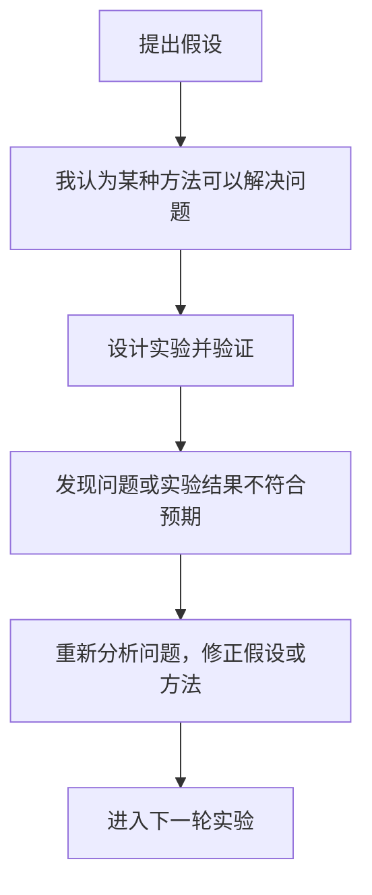

- 1. 发现研究问题
    
    观察现实中的某种现象，发现现有技术存在不足，或者发现某个尚未解决的问题。
    
    例如：现有 TLS 流量混淆方法在智能家居 IoT 场景下，可能无法兼顾流量混淆效果和通信时延。
    
- 2. 文献调研与问题定义
    
    阅读已有论文，了解其他研究者做过什么、解决了什么、还存在哪些不足。
    
    明确自己的研究边界，避免重复研究，并找到真正值得解决的问题。
    
- 3. 提出研究假设或解决思路
    
    根据理论分析和已有研究，提出自己的解决方案。
    
    例如：能否根据网络状态，自适应地调整 TLS 数据包的分割策略？
    
- 4. 设计研究方法
    
    将想法转化成可以验证的技术方案，包括算法、系统架构、数学模型、实验指标和对照组。
    
    这一步要回答：如何证明自己的方法有效？
    
- 5. 实现与实验
    
    编写代码、搭建实验环境、采集数据、运行实验。
    
    观察方法是否有效，记录实验结果，并与基线方法进行对比。
    
- 6. 分析实验结果
    
    不只是看实验有没有成功，还要分析为什么成功、为什么失败，以及结果是否支持最初的假设。
    
    必要时重新设计方案、补充实验，甚至推翻最初的假设。
    
- 7. 总结研究结论
    
    回答最初提出的研究问题，明确研究贡献、适用条件、局限性和未来研究方向。
    
- 8. 撰写与发表论文
    
    将研究背景、问题、方法、实验、结果和结论整理成学术论文，投稿期刊或会议，经过同行评审后，根据意见修改，最终录用或发表。

## 一个典型的科研迭代过程

